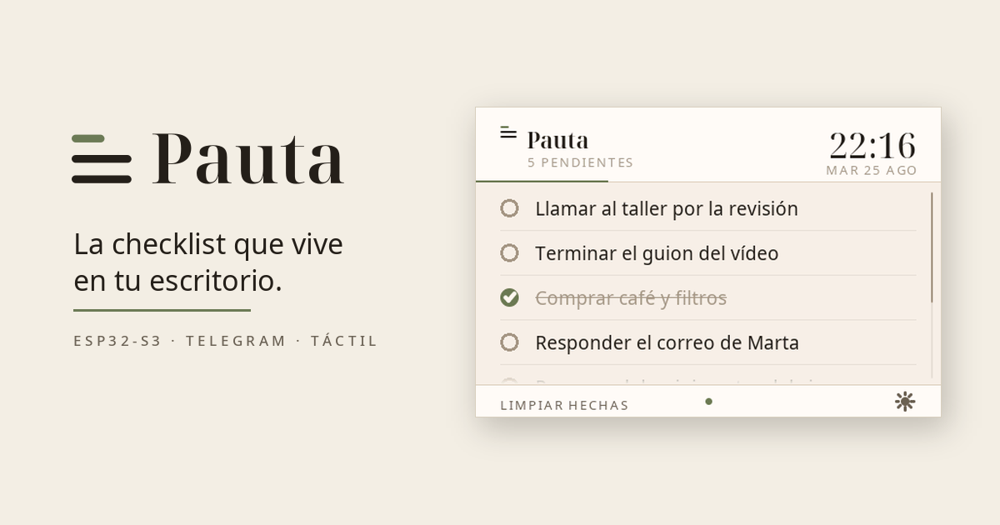
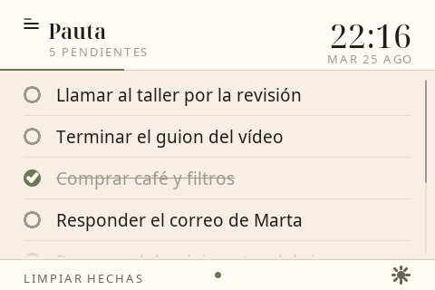
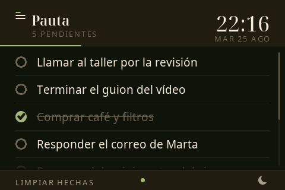
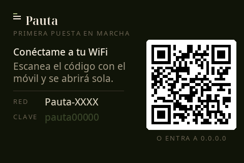
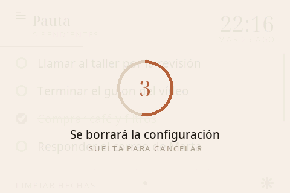

<p align="center">
  
</p>

<h1 align="center">Pauta</h1>

<p align="center">La checklist que vive en tu escritorio.</p>

<p align="center"><a href="README_en.md">In English</a></p>

---

Le escribes por Telegram y aparece en la pantalla. Tocas un renglón y se tacha.
No hay app que abrir ni pestaña que buscar: está encendida encima de la mesa,
como una libreta que se actualiza sola.

**Pauta** son las rayas guía de un cuaderno. También es lo que toca hacer.

## Cómo se usa

<p align="center">
  
  
</p>

Le mandas un mensaje al bot y se apunta. Si mandas varias líneas, apunta una
tarea por línea. Si una tarea es demasiado larga, la recorta y te avisa. Caben
40 tareas, o menos si son muy largas; si un mensaje no entra entero, te dice
cuántas ha apuntado. En la pantalla tocas un renglón para tacharlo, y el bot
te lo confirma.

| En Telegram | |
|---|---|
| *cualquier texto* | Lo apunta |
| `/list` | Ver la lista |
| `/done N` · `/undo N` | Tachar o reabrir la tarea N |
| `/del N` | Borrarla |
| `/del 2 3` · `/done 1,4` | Varias de una vez |
| `/clear` | Quitar todas las tachadas |
| `/start` | Bienvenida y ayuda |
| `/help` | Ver todas las órdenes y la versión del firmware |
| `/` | Menú de Telegram con las órdenes y lo que hace cada una |

N es el número que sale en `/list`. Al borrar, los de debajo se recolocan:
para quitar varias, mejor de una vez con varios números. Si te dejas el
número (un `/done` a secas desde el menú), te recuerda cómo va y te enseña la
lista. Solo entiende texto: si le mandas una foto, una nota de voz o una
pegatina, te pide que se lo escribas.

| En la pantalla | |
|---|---|
| Tocar un renglón | Tacharlo o reabrirlo |
| Arrastrar | Recorrer la lista, con inercia al soltar |
| "Limpiar hechas" | Quitar las tachadas |
| Sol / luna | Cambiar entre papel de día y de noche |
| Mantener pulsado el logo | Olvidar WiFi y token, y volver al portal (la lista se queda) |

Si la lista no cabe entera y llega una tarea nueva, la pantalla baja sola
hasta enseñarla. Si la has tocado hace menos de 5 segundos se queda quieta,
para no moverte lo que estabas leyendo.

Si la conexión con Telegram falla durante más de un minuto, el pie dice qué
pasa con palabras (sin WiFi, token no válido…); qué significa cada aviso está
en la [guía de instalación](docs/instalacion.md#avisos-en-el-pie). Con la
lista vacía, la pantalla te recuerda el @usuario de tu bot.

La interfaz y el bot hablan **español o inglés**; se elige en la puesta en
marcha.

## Qué necesitas

- Una **Makerfabs ESP32-S3 Parallel TFT with Touch 3.5"**, con táctil
  capacitivo. Sirven la V1.0 y la V2.0 (esta compila, pero está sin probar en
  hardware real), aunque **usan pines y PSRAM distintos** y hay que decírselo
  al firmware. Está explicado en [docs/hardware.md](docs/hardware.md).
- Un cable USB-C.
- Un bot de Telegram: escríbele `/newbot` a [@BotFather](https://t.me/botfather)
  y te dará un token.

## Instalación

El resumen es: instalar `arduino-cli`, compilar y flashear.

```bash
git clone https://github.com/Ignacio-Aranda/pauta.git
cd pauta
```

El paso a paso completo, con las dependencias y el detalle de cada opción,
está en **[docs/instalacion.md](docs/instalacion.md)**.

## Puesta en marcha

<p align="center">
  
</p>

Al encenderla por primera vez no sabe a qué WiFi conectarse, así que **monta su
propio punto de acceso** y enseña un QR. Lo escaneas con el móvil, te conecta a
su red y se abre sola la página de configuración: eliges tu WiFi, escribes la
contraseña, pegas el token del bot y eliges idioma.

Se reinicia y ya está; después escríbele a tu bot. El primer mensaje que le
llegue, sea cual sea (no hace falta que sea `/start`), vincula la pantalla a
tu chat. Todo queda guardado en la placa, y sobrevive tanto a reinicios como a
volver a flashear.

**El token solo se escribe en esa página y solo vive en la memoria de la
placa.** No está en este repositorio ni sale del dispositivo.

### Si se va la luz

Si al encender no encuentra tu WiFi (lo normal tras un apagón: el router tarda
más que ella en arrancar), vuelve a enseñar el portal, ahora con «sin conexión
con» y el nombre de tu red arriba. No hace falta tocar nada: mientras nadie
esté conectado a su red, sigue probando la tuya, y cuando la conexión aguanta
unos segundos se reinicia y vuelve a la lista con todas las tareas. Si lo que
ha cambiado es la red o su contraseña, el QR sigue ahí para configurarla otra
vez.

### Cambiar el WiFi o el token más adelante

<p align="center">
  
</p>

Mantén el dedo sobre el logo. A los 3 segundos aparece una cuenta atrás de 5;
si sueltas antes, no pasa nada. Si la dejas llegar a cero, la placa olvida el
WiFi, el token, el idioma, el tema y el chat vinculado, y vuelve al portal,
lista para otro WiFi u otro token. **La lista de tareas se queda.** Cuando la
configures, escríbele otra vez a tu bot para vincularla.

La placa no cifra su memoria, y el gesto marca la configuración como borrada
pero no la machaca: cualquiera con la placa y un cable USB puede leer lo que
guarda. Para regalarla o venderla, lo definitivo es borrar la flash entera y
volver a flashear; está en la
[guía de instalación](docs/instalacion.md#regalarla-o-venderla).

## Cómo está hecho

- La red corre en un núcleo y la pantalla en el otro, así que el sondeo de
  Telegram nunca congela el táctil.
- Todo se dibuja en un lienzo completo en PSRAM y se vuelca de una vez: unos
  8 ms por fotograma, sin parpadeo.
- Las tildes y la eñe salen porque el proyecto **genera sus propias fuentes
  suavizadas**; las que trae la librería gráfica solo cubren ASCII. Lo que
  esas fuentes no tienen, como los emojis, se omite en la pantalla en vez de
  salir como un recuadro; en Telegram se sigue viendo tal cual.
- La conexión con Telegram solo se fía de las dos CA raíz fijadas en el
  firmware: la G2 de GoDaddy, de la que cuelga hoy, y la R1, con la que
  GoDaddy ya firma los certificados nuevos. No acepta cualquier certificado.

## Documentación

| | |
|---|---|
| [Hardware](docs/hardware.md) | La placa, los pines y cómo saber tu revisión |
| [Instalación](docs/instalacion.md) | Compilar, flashear y personalizar |
| [Registro de cambios](CHANGELOG.md) | Qué cambia en cada versión |

## Licencia

Código MIT; fuentes Noto bajo SIL OFL 1.1.

- El código: MIT, ver [LICENSE](LICENSE).
- Las fuentes de `firmware/pauta/fonts/`, generadas a partir de Noto Sans y
  Noto Serif Display: SIL Open Font License 1.1, ver
  [OFL.txt](firmware/pauta/fonts/OFL.txt).
